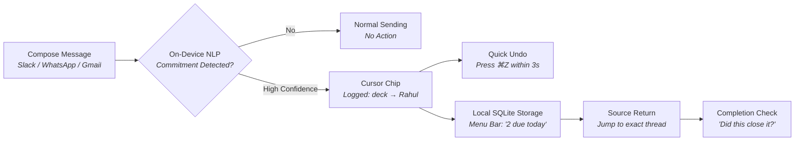

<div align="center">

# Due
### *A Promise Tracker That Fills Itself In*

A lightweight macOS menu-bar app that automatically captures the commitments you make across Slack, WhatsApp, and Gmail — keeping you accountable without maintaining yet another to-do list.

[](https://apple.com)
[](https://sqlite.org)
[](#privacy-and-trust-by-design)
[](#current-status-and-validation)

<br/>

> **Core Principle:** Due tracks promises **you make**, not every random task in your life. You should never have to enter commitments manually.

</div>

---

## Table of Contents

- [The Problem](#the-problem)
- [How It Works](#how-it-works)
- [User Experience and Mockups](#user-experience-and-mockups)
- [MVP Scope vs. Future Vision](#mvp-scope-vs-future-vision)
- [Technical Architecture](#technical-architecture)
- [Data Model](#data-model)
- [Privacy and Trust by Design](#privacy-and-trust-by-design)
- [Risks and Mitigation Matrix](#risks-and-mitigation-matrix)
- [Development Roadmap](#development-roadmap)
- [Target Audience and Pricing](#target-audience-and-pricing)
- [Success Metrics](#success-metrics)

---

## The Problem

Every day, informal commitments slip through the cracks of daily communication:

```text
"I'll send the revised deck by Friday."
"Let me check with the team and get back to you."
"I'll share the Figma link tonight."
"I'll review your PR this afternoon."
```

- **Traditional task managers fail here:** Users rarely open project management software just to record an informal promise made mid-conversation.
- **Forgotten promises carry high costs:** Damaged trust with clients, stalled colleagues, and reactive follow-ups.
- **The Due Solution:** Convert fleeting conversational promises into an organized, lightweight, and automatically maintained commitment record.

---

## How It Works



1. **Write normally:** Compose messages as you always do.
2. **Instant detection:** Due identifies commitments and displays a subtle 2-second confirmation chip near your cursor.
3. **Instant undo (`⌘Z`):** Made an error or triggered an unwanted detection? One keystroke cancels the capture.
4. **Glanceable menu-bar counter:** View pending promises (`2 due today`) directly in your macOS menu bar.
5. **Direct thread deep-linking:** Click any item to return directly to the originating Slack channel, WhatsApp conversation, or email thread.
6. **Smart closure prompts:** When you subsequently send a deliverable, Due asks: *"Did this close it?"* — resolve with one click.
7. **Monday morning executive digest:** Start each week with a concise summary of promises kept, open obligations, and contacts awaiting responses.

---

## User Experience and Mockups

### 1. In-Context Cursor Chip (Non-intrusive)
```text
┌────────────────────────────────────────────────────────┐
│ I'll send the revised deck to Rahul by Friday afternoon│
└────────────────────────────────────────────────────────┘
          ▲
          └─── Logged: revised deck → Rahul · Fri (⌘Z to undo)
```

### 2. macOS Menu-Bar Tray
```text
┌────────────────────────────────────────────────────────┐
│  Due                                       2 due today│
├────────────────────────────────────────────────────────┤
│  OVERDUE                                               │
│  • Follow up on proposal with Sarah       (Yesterday)  │
│                                                        │
│  DUE TODAY                                             │
│  • Send revised pitch deck → Rahul        (By 5:00 PM) │
│  • Share Figma access link → Design Team  (Tonight)    │
│                                                        │
│  UPCOMING                                              │
│  • Review backend pull request #42        (Thursday)   │
├────────────────────────────────────────────────────────┤
│  Preferences...               Weekly Summary...        │
└────────────────────────────────────────────────────────┘
```

### 3. Fulfill and Close Suggestion
```text
┌────────────────────────────────────────────────────────┐
│ Due: Fulfillment Detected                             │
│ "Looks like you just sent Rahul a keynote deck.        │
│  Did this fulfill your Friday commitment?"             │
│                                                        │
│       [ Dismiss ]            [ Yes, Mark Kept ]        │
└────────────────────────────────────────────────────────┘
```

---

## MVP Scope vs. Future Vision

| Feature / Capability | MVP (Weeks 1–4) | Phase 2 (Follow-on) | Future Vision |
| :--- | :---: | :---: | :---: |
| **Platform** | macOS Menu Bar (Swift/AppKit) | macOS + Menu Bar | iOS Companion App |
| **Promise Capture** | Outgoing promises you make | Track promises made to you | Shared team commitments |
| **Supported Apps** | Slack, WhatsApp Desktop, Gmail | Apple Mail, Notion, Teams | Universal accessibility |
| **Inference Engine** | Local on-device NLP (CoreML / Foundation) | On-device + Hybrid | Custom fine-tuned adapters |
| **Storage** | Local SQLite (`~/.Due/Due.db`) | Optional encrypted iCloud Sync | Team workspace sync |
| **GitHub Integration** | Deferred | Review & PR status tracking | CI/CD build failure alerts |
| **Reminders** | Native macOS notifications | Smart calendar suggestions | Voice assistant / Bot check-ins |

> [!IMPORTANT]
> **MVP Focus:** Tracking promises you make to others is the primary value proposition. Ingesting other people's promises, monitoring GitHub workflows, and automatic calendar slot booking are deferred to subsequent releases.

---

## Technical Architecture

```text
┌─────────────────────────────────────────────────────────────────────────┐
│                          USER APPLICATION LAYER                         │
│     Slack Desktop      ·      WhatsApp Desktop      ·      Gmail (Web)  │
└───────────────────┬───────────────────────────────────┬─────────────────┘
                    │ (Accessibility API)               │ (Browser Extension)
                    ▼                                   ▼
┌─────────────────────────────────────────────────────────────────────────┐
│                        Due CAPTURE ENGINE                              │
│  • Detects focused outgoing input field only                            │
│  • Triggers on message submission / send event                          │
│  • Strict zero-screen-scraping policy                                   │
└───────────────────────────────────┬─────────────────────────────────────┘
                                    │ Outgoing Text String
                                    ▼
┌─────────────────────────────────────────────────────────────────────────┐
│                 ON-DEVICE REASONING & EXTRACTION                        │
│  • Apple Foundation Models / CoreML local inference                     │
│  • Extracts: [Actionable Commitment], [Recipient], [Due Date/Time]      │
│  • Computes confidence score (ignores low-confidence/vague remarks)     │
└───────────────────────────────────┬─────────────────────────────────────┘
                                    │ Validated Commitment Record
                                    ▼
┌───────────────────────────────────┴─────────────────────────────────────┐
│                            LOCAL DATA STORE                             │
│       SQLite Database  ·  Local Notification Queue  ·  macOS Tray       │
└─────────────────────────────────────────────────────────────────────────┘
```

1. **Capture Pipeline:** Utilizes the macOS Accessibility API (`AXUIElement`) focused strictly on the active text composer upon message submission. Web applications (Gmail) utilize a lightweight browser extension.
2. **Intent Parsing:** Powered by Apple Foundation Models / CoreML to extract the action, recipient, and deadline, while evaluating confidence.
3. **Deep Linking:** Records workspace URLs (such as `slack://` deep links or email thread URIs) to enable direct return to source conversations.
4. **Local Store:** Encrypted on-device SQLite database with zero cloud relay.

---

## Data Model

Stored in local SQLite (`~/.Due/Due.db`):

| Column | Type | Description | Example |
| :--- | :--- | :--- | :--- |
| `id` | `TEXT PRIMARY KEY` | UUIDv4 commitment identifier | `c8b13a82-...` |
| `commitment_text` | `TEXT NOT NULL` | Extracted action description | `"Send revised pitch deck"` |
| `recipient_name` | `TEXT` | Target person or team involved | `"Rahul"` |
| `due_at` | `DATETIME` | Normalized ISO-8601 deadline | `2026-10-30T17:00:00Z` |
| `source_app` | `TEXT NOT NULL` | Identifier of originating app | `"com.tinyspeck.slackmacgap"` |
| `source_reference`| `TEXT` | Safe deep link or thread URI | `"slack://thread?id=..."` |
| `confidence` | `REAL NOT NULL` | Parsing confidence (0.00 – 1.00) | `0.94` |
| `status` | `TEXT NOT NULL` | Lifecycle state | `'open'`, `'completed'`, `'dismissed'` |
| `created_at` | `DATETIME NOT NULL`| Timestamp when detected | `2026-10-24T21:50:00Z` |
| `completed_at` | `DATETIME` | Timestamp marked as fulfilled | `2026-10-30T16:45:10Z` |
| `reminder_at` | `DATETIME` | Scheduled local alert timestamp | `2026-10-30T09:00:00Z` |

---

## Privacy and Trust by Design

> [!NOTE]
> Privacy is the foundational design requirement of Due. Because Due operates alongside daily communications, trust must be absolute.

- **On-Device Exclusivity:** Parsing and data persistence run entirely locally. User text is never transmitted to cloud LLMs or external servers.
- **Outgoing Only:** Due inspects only text actively typed and submitted by the user. It explicitly ignores incoming messages and feeds from others.
- **No Screen Ingestion:** Due does not take background screenshots, record global keystrokes, or run OCR across the display.
- **Instant Undo and Erasure:** Every logged item can be revoked within seconds via `⌘Z` or permanently deleted from SQLite at any time.
- **Radical Transparency:** The onboarding process clearly explains required permissions (macOS Accessibility) and includes test verification before activation.

---

## Risks and Mitigation Matrix

| Risk Factor | Impact | Mitigation Strategy |
| :--- | :--- | :--- |
| **False Positives**<br>*(e.g., "I'll think about it")* | **High:** Erodes user trust quickly | Conservative detection threshold. Only log commitments with clear verbs and timeframes; ambiguous text requires manual confirmation or is disregarded. |
| **Accessibility API Drift**<br>*(Electron updates breaking hooks)* | **High:** Capture stops functioning silently | Automated integration tests against Slack/WhatsApp Desktop releases. Fallback hotkey/clipboard trigger if API access is disrupted. |
| **Vague Deadlines**<br>*(e.g., "by EOD", "next week")* | **Medium:** Inaccurate reminder scheduling | Infer deadlines based on configured workday completion (e.g., 5:00 PM local). Always provide a quick date-picker to adjust. |
| **Privacy Permission Resistance** | **High:** Users decline Accessibility access | Transparent onboarding illustrating that only the active composer field is accessed; open-source core capture daemon for community review. |

---

## Development Roadmap

### Phase 1: Feasibility and Foundation
- [ ] Benchmark macOS Accessibility API (`AXUIElement`) against Slack Desktop and WhatsApp Desktop.
- [ ] Validate isolated outgoing text extraction without full-window scraping.
- [ ] Build proof-of-concept browser extension for Gmail compose views.
- [ ] Prototype CoreML / on-device NLP intent classifier across varied commitment patterns.
- [ ] Define permission and privacy onboarding workflow.

### Phase 2: Core MVP
- [ ] Native Swift/AppKit menu-bar daemon and status item.
- [ ] Cursor confirmation chip with 3-second `⌘Z` undo hook.
- [ ] SQLite database implementation (`Due.db`) with migrations and encryption.
- [ ] Due / Upcoming / Overdue popover view with thread deep links.
- [ ] Native macOS notification scheduler.
- [ ] One-click completion prompt on subsequent message or file activity.

### Phase 3: Weekly Review and Beta
- [ ] Monday morning summary view (promises made, kept, overdue, follow-ups needed).
- [ ] Configurable workday hours, deadline heuristics, and quiet hours.
- [ ] Closed private beta with 50 founders, agency leads, and freelancers.
- [ ] Measure precision, recall, and undo frequency.

### Phase 4: Expansion and Integrations
- [ ] Optional end-to-end encrypted iCloud Sync.
- [ ] Inbound commitment tracking (promises made to you).
- [ ] GitHub review, PR merge, and CI alert monitoring.
- [ ] Calendar-aware focus slot recommendations.

---

## Target Audience and Pricing

### Ideal Early Adopters
- **Agency Leads and Account Managers:** Managing dozens of client promises across multiple channels simultaneously.
- **Freelancers and Consultants:** Whose credibility and repeat business depend directly on keeping informal commitments.
- **Founders and Executives:** Addressing numerous ad-hoc requests and commitments throughout the day.
- **Software Engineers and Team Leads:** Coordinating PR reviews, handoffs, and architectural follow-ups.

### Commercial Hypothesis
- **Free Tier:** First 20 automatically captured promises.
- **Monthly Subscription:** **$5 / month** (continuous updates, support, extension sync).
- **Perpetual License:** **$49 one-time** (1 year of updates, local-first indefinitely).

---

## Success Metrics

```text
Precision Score   ───►  > 90% of logged items are genuine commitments
Undo Rate         ───►  < 8% of triggers revoked via ⌘Z
Fulfillment Rate  ───►  > 70% of tracked commitments marked "Kept"
Retention         ───►  > 40% weekly active usage after Day 30
Trust Score       ───►  Zero unprompted background network egress
```

---

## Current Status and Validation

**Stage:** Product concept and MVP planning.

Validation will begin with a short 20-second screen capture demonstrating real-time message detection, cursor chip feedback, and menu-bar entry, shared with early target users to evaluate demand prior to full production development.

---

## License

*Proprietary — All rights reserved. Licensing terms will be finalized prior to public distribution.*
